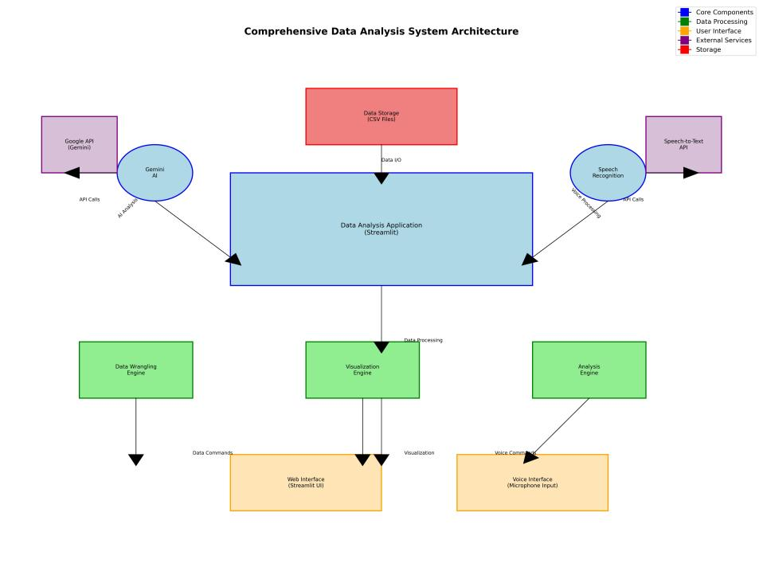
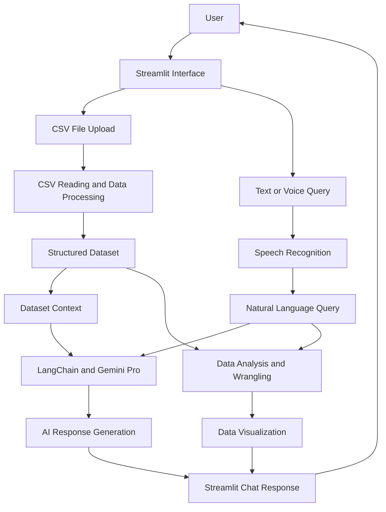
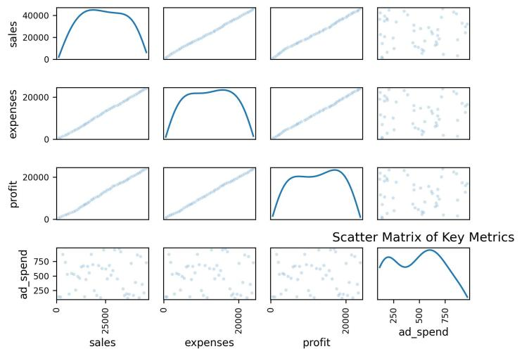
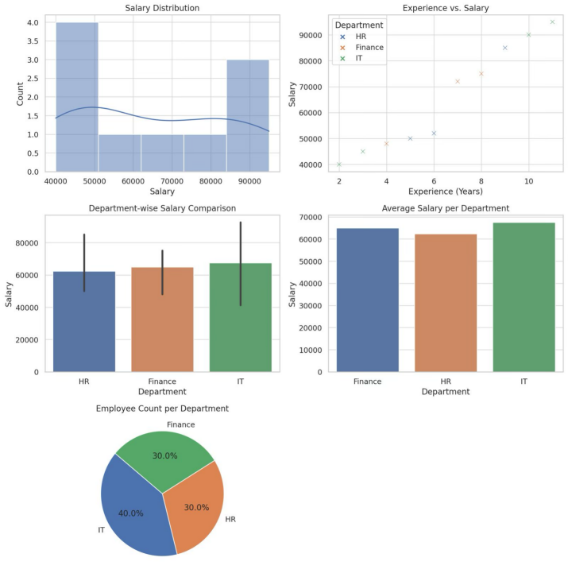
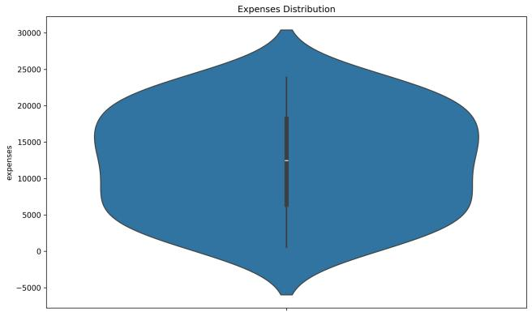
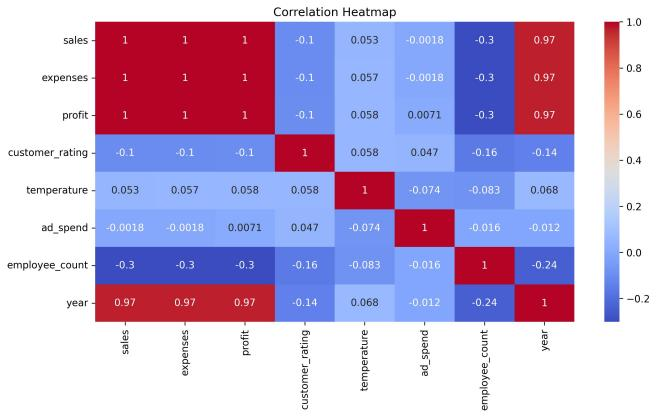
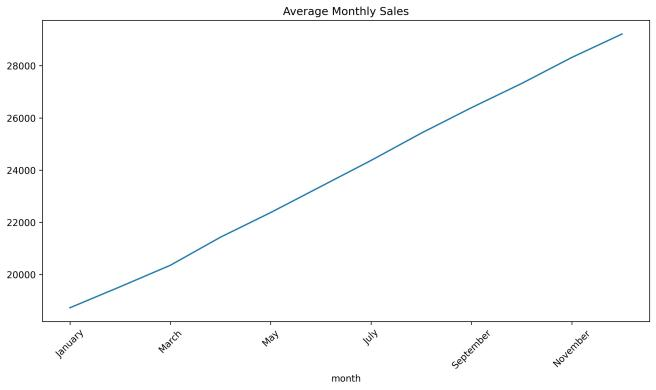
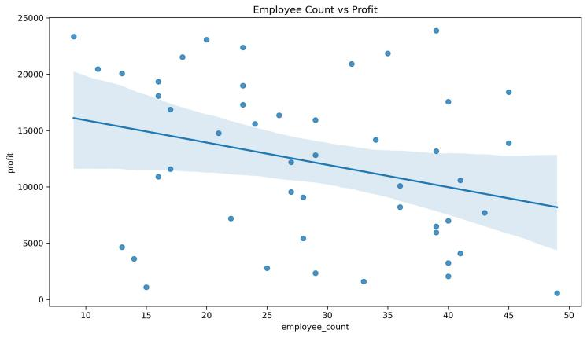

# Employee Data Insights
### Chat-Based Data Analysis with Streamlit, Google Gemini Pro & Speech Recognition

An AI-powered conversational data analytics application that enables users to explore structured CSV datasets through natural-language questions, data-wrangling commands, interactive visualizations, and voice-based input.

**Project Type:** Academic Project  
**Institution:** Vellore Institute of Technology (VIT), India  
**Domain:** Data Science | Generative AI | Conversational Analytics

---

## 1. Project Overview

Exploring structured datasets traditionally requires knowledge of programming languages, SQL, or business intelligence tools. This can make data analysis challenging for users without technical expertise.

**Employee Data Insights** explores a more accessible approach by combining conversational AI with data analytics.

Users can upload CSV datasets and interact with their data using natural-language questions instead of manually writing queries or code.

The application integrates Streamlit for the interactive interface, Python for data processing, and Google Gemini Pro for natural-language understanding and response generation.

It also explores voice-based interaction and natural-language data-wrangling capabilities.

## 2. Key Features

- **CSV File Upload:** Upload structured datasets through an interactive Streamlit interface.
- **Conversational Data Analysis:** Ask questions about uploaded datasets using natural language.
- **AI-Powered Responses:** Leverage Google Gemini Pro for context-aware analytical responses.
- **Data Preprocessing:** Read, inspect, and prepare uploaded CSV datasets for analysis.
- **Natural-Language Data Wrangling:** Express supported data operations using plain English.
- **Interactive Visualizations:** Explore distributions, comparisons, trends, and correlations.
- **Speech Recognition:** Support voice-based queries through speech-to-text functionality.
- **Conversational Interface:** Interact with datasets through a chat-based application.

*Note: Feature descriptions are based on the academic project report. Refer to the current source code for implementation-specific details.*

## 3. Example Use Cases

Using an employee dataset containing fields such as Name, Department, Salary, and Experience, users can explore questions such as:

- Which department has the highest average salary?
- Show the salary distribution.
- Compare average salaries across departments.
- Is there a relationship between salary and experience?
- Rename the Salary column to Monthly_Income.
- Drop a specified column.

The exact operations supported depend on the implementation in the application.

## 4. System Architecture

The following diagram illustrates the proposed system architecture documented in the academic project report.



### Application Workflow

The high-level workflow of the application is represented below.



*This is a conceptual workflow based on the project report, not a verified execution trace of every function in app.py.*

## 5. Dataset Description

The project report illustrates an employee-style dataset with the following attributes:

| Attribute | Description |
|---|---|
| ID | Unique employee identifier |
| Name | Employee name |
| Department | Employee department |
| Salary | Employee salary |
| Experience (Years) | Years of professional experience |

### Sample Dataset Structure


The sample dataset demonstrates how structured employee information can be used for exploratory analysis, comparisons, and visualizations.

## 6. Data Visualization

The application explores multiple visualization techniques to make analytical insights easier to understand.

### Visualization Gallery



### Analytics Dashboard



### Distribution Analysis



### Correlation Analysis



### Trend Analysis



### Scatter Analysis



These figures illustrate the analytical and visualization concepts documented in the project report.

## 7. Technology Stack

| Category | Technologies |
|---|---|
| Programming Language | Python |
| Frontend / Interface | Streamlit |
| Generative AI | Google Gemini Pro |
| LLM Integration | LangChain |
| Data Processing | Pandas, NumPy |
| Data Visualization | Matplotlib, Seaborn |
| Speech Processing | SpeechRecognition |
| Data Input | CSV |

**Additional technologies discussed in the report:** ChromaDB, embeddings, and CSVLoader. Their implementation should be verified against the source code before treating them as active application components.

## 8. Repository Structure

```text
Employee-Data-Insights/
│
├── app.py
├── requirements.txt
├── .env.example
├── .gitignore
├── README.md
│
└── screenshots/
    │
    ├── architecture/
    │   └── image1.jpeg
    │
    ├── dataset/
    │   └── dataset-overview.png
    │
    └── visualizations/
        ├── analytics-dashboard.png
        ├── correlation-heatmap.jpeg
        ├── distribution-analysis.jpeg
        ├── distribution-sales.jpeg
        ├── scatter-analysis.jpeg
        ├── trend-analysis.jpeg
        └── visualization-gallery.jpeg
```

The screenshots directory contains supporting project illustrations. The application source remains in the original app.py file.

## 9. Getting Started

### Prerequisites

- Python 3.9 or a compatible version for the dependencies.
- Google Gemini API key with access to the configured model.
- Microphone access for voice-based interaction.
- Git installed on your system.

### Step 1: Clone the Repository

```bash
git clone https://github.com/jewelreddys/Building-a-Chat--Based-Analysis-App-with-Streamlit-and-Gemini-Pro-with-Speech-Recognition.git
```

```bash
cd Building-a-Chat--Based-Analysis-App-with-Streamlit-and-Gemini-Pro-with-Speech-Recognition
```

### Step 2: Create a Virtual Environment

```bash
python -m venv .venv
```

Activate the environment.

**Windows:**

```bash
.venv\Scripts\activate
```

**macOS / Linux:**

```bash
source .venv/bin/activate
```

### Step 3: Install Dependencies

```bash
pip install -r requirements.txt
```

### Step 4: Configure API Credentials

Create a local `.env` file or configure Streamlit secrets according to the application's existing configuration.

Example:

```env
GOOGLE_API_KEY=your_gemini_api_key
```

Use the exact environment variable expected by app.py. Never expose actual API credentials in the repository.

### Step 5: Run the Application

```bash
streamlit run app.py
```

Open the local URL displayed in your terminal to access the application.

## 10. Security and Data Privacy

Security considerations for the project include:

- Keeping API credentials outside source control.
- Excluding `.env` files from Git commits.
- Avoiding the upload of confidential or sensitive datasets to external AI services.
- Validating AI-generated analytical responses.
- Handling invalid CSV files, missing values, and API errors.
- Avoiding execution of arbitrary code generated by an LLM.
- Informing users when data or query context is transmitted to an external AI provider.

## 11. Future Enhancements

Potential future improvements identified in the project report include:

- Predictive analytics and trend forecasting.
- Anomaly detection in structured datasets.
- Multilingual natural-language querying.
- SQL and NoSQL database integrations.
- Enhanced data security and privacy controls.
- Improved conversational analytics capabilities.

These are proposed enhancements and are not represented as completed features.

## 12. Project Documentation

The academic project report is titled:

**Employee Data Insights: Building a Chat-Based Analysis App with Streamlit and Gemini Pro with Speech Recognition**

The report covers the motivation, proposed system architecture, technology stack, dataset description, implementation workflow, and visualization approach.

## 13. Author

**S. Jewel Reddy**

Integrated M.Tech – Computer Science (Data Science)  
Vellore Institute of Technology (VIT), India

[GitHub Profile](https://github.com/jewelreddys)

---

*This repository is maintained as an academic and technical portfolio project. Implementation details, dependencies, and model compatibility should be verified against the current source code before deployment.*
